<!-- Visual reference: Avi Vashishta’s “Three Worlds” GitHub profile.
     https://www.avivashishta.com/blog/github-profile-readme-animated-svg-cards
     The artwork is generated by scripts/render_readme_cards.py. -->

 
 
 
 
<picture><source media="(prefers-color-scheme: dark)" srcset="./cards/title-coding-dark.svg" /></picture> 

AI engineer · Security researcher · Computer science student at BITS Pilani, Dubai Campus · GDGoC BPDC organizer 
<a href="https://www.shipmitra.net">ShipMitra</a> / <a href="https://www.linkedin.com/in/het-patel-1bb76a266/">LinkedIn</a> / <a href="https://portfolio-ten-mu-w8z0dqhewz.vercel.app/">Portfolio</a>

