<!-- Visual reference: Avi Vashishta’s “Three Worlds” GitHub profile.
     https://www.avivashishta.com/blog/github-profile-readme-animated-svg-cards
     The artwork is generated by scripts/render_readme_cards.py. -->

<a href="https://www.shipmitra.net"><picture><source media="(prefers-reduced-motion: reduce)" srcset="./cards/hero.svg#still" /></picture></a> 
<picture><source media="(prefers-reduced-motion: reduce)" srcset="./cards/heatmap.svg#still" /></picture> 
<picture><source media="(prefers-reduced-motion: reduce)" srcset="./cards/activity.svg#still" /></picture> 
<a href="https://www.shipmitra.net"><picture><source media="(prefers-reduced-motion: reduce)" srcset="./cards/build.svg#still" /></picture></a><a href="https://www.shipmitra.net"><picture><source media="(prefers-reduced-motion: reduce)" srcset="./cards/brand.svg#still" /></picture></a><a href="https://www.shipmitra.net"><picture><source media="(prefers-reduced-motion: reduce)" srcset="./cards/valuation.svg#still" /></picture></a> 
<picture><source media="(prefers-reduced-motion: reduce)" srcset="./cards/title-coding.svg#still" /></picture> 
<a href="https://github.com/Hetpatel01021111/FinBot"><picture><source media="(prefers-reduced-motion: reduce)" srcset="./cards/repo-finbot.svg#still" /></picture></a><a href="https://github.com/Hetpatel01021111/AeroTrackAI"><picture><source media="(prefers-reduced-motion: reduce)" srcset="./cards/repo-aerotrackai.svg#still" /></picture></a><a href="https://github.com/Hetpatel01021111/Fractal"><picture><source media="(prefers-reduced-motion: reduce)" srcset="./cards/repo-fractal.svg#still" /></picture></a>

AI engineer · Security researcher · Computer science student at BITS Pilani, Dubai Campus · GDGoC BPDC organizer 
<a href="https://www.shipmitra.net">ShipMitra</a> / <a href="https://www.linkedin.com/in/het-patel-1bb76a266/">LinkedIn</a> / <a href="https://portfolio-ten-mu-w8z0dqhewz.vercel.app/">Portfolio</a>

